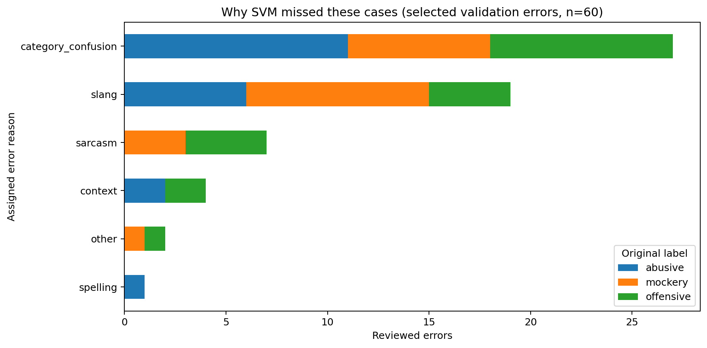
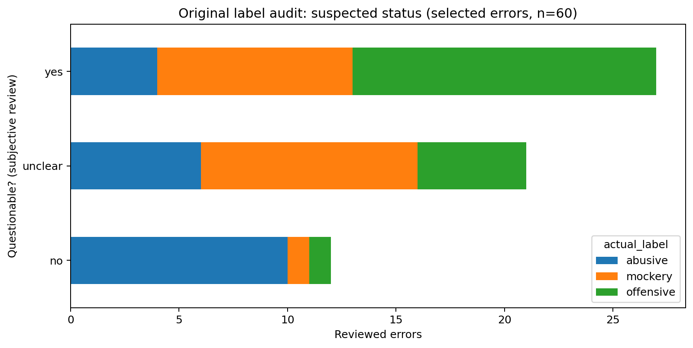
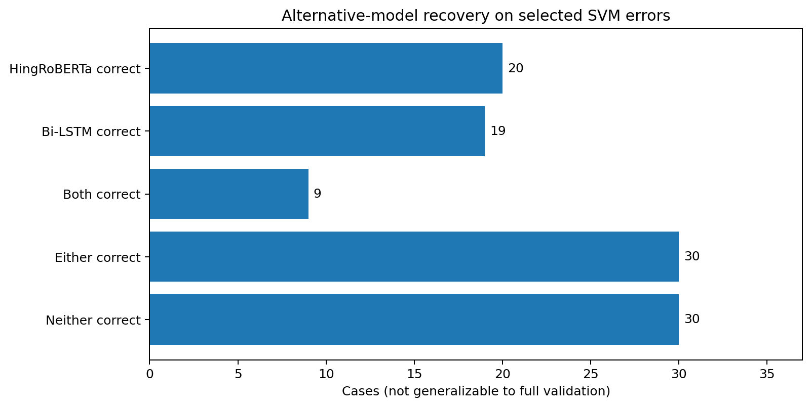
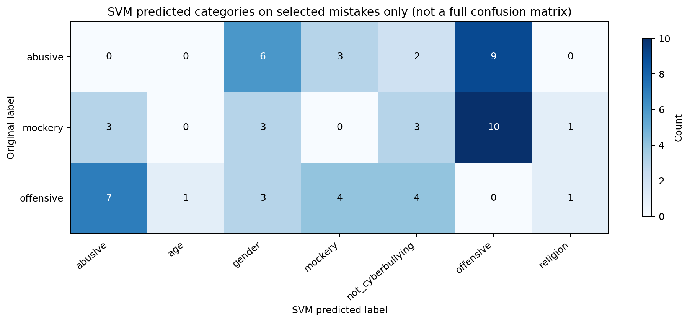

# MixBhasha v5 — Cyberbullying error audit

**Scope:** 60 **selected TF-IDF SVM validation mistakes**, not a random selection from all validation posts. Original classes in this review are abusive, mockery, offensive. This is **exploratory qualitative review**, not a new held-out evaluation or annotation-quality prevalence estimate.

## What was marked

| Reviewer-assigned reason | Count | Share within selected mistakes |
|---|---:|---:|
| `category_confusion` | 27 | 45.0% |
| `slang` | 19 | 31.7% |
| `sarcasm` | 7 | 11.7% |
| `context` | 4 | 6.7% |
| `other` | 2 | 3.3% |
| `spelling` | 1 | 1.7% |

## Original annotation audit (not verified relabeling)

| Subjective flag | Count | Share within selected mistakes |
|---|---:|---:|
| `yes` | 27 | 45.0% |
| `unclear` | 21 | 35.0% |
| `no` | 12 | 20.0% |

The 'yes' and 'unclear' flags indicate a need for **independent annotation review**, not established errors. The percentage **must not** be extrapolated to the full dataset because sampling was conditioned on SVM mistakes from three difficult classes.

## Alternative-model agreement

On these 60 examples, HingRoBERTa matches the existing label on **20** and Bi-LSTM Attention on **19**. Both match on **9**, at least one on **30**, neither on **30**. An oracle could pick the correct model in some instances, but **this does not establish that a practical ensemble will improve validation performance**.

## Interpretive hypotheses to test

- **Category boundaries:** Offensive, abusive and mockery labels overlap semantically. Build a written annotation rubric with targeted-attack, profanity-use, sarcasm and identity-attack examples.
- **Code-mixed slang:** Slang may express aggression, teasing or informal frustration depending on target and context. More lexical features alone may reinforce shortcuts.
- **Shortcut patterns:** Inspect cases where innocuous identity terms trigger age, religion or gender predictions; no rate can be estimated from this review alone.
- **Out-of-domain/noise:** Inspect unusual language, fragments, and context-free posts in the **training split** before making data-cleaning changes.

## Next steps without validation contamination

1. Freeze this validation split; preserve all original labels and the saved model outputs.
2. Write annotation rules; conduct blinded independent double review on a **random sample of validation records** for a more representative label-quality estimate, *without changing the benchmark scores*.
3. Audit the **training split** for near-duplicates and ambiguous labels. Any manual corrections must have provenance and versioned training-only CSVs.
4. Tune SVM via stratified cross-validation **only on training data**; retain one declared validation comparison. Evaluate hard-case recall and per-class F1, not only global macro-F1.
5. Compare fixed-weight or training-calibrated ensemble candidates; a validation-only apparent improvement requires later confirmation on a genuinely independent set.

**Data release:** Raw social posts, reviewer notes, personal identifiers, and the review CSV are omitted from this public report. Check source dataset terms before distributing any text or checkpoints.
